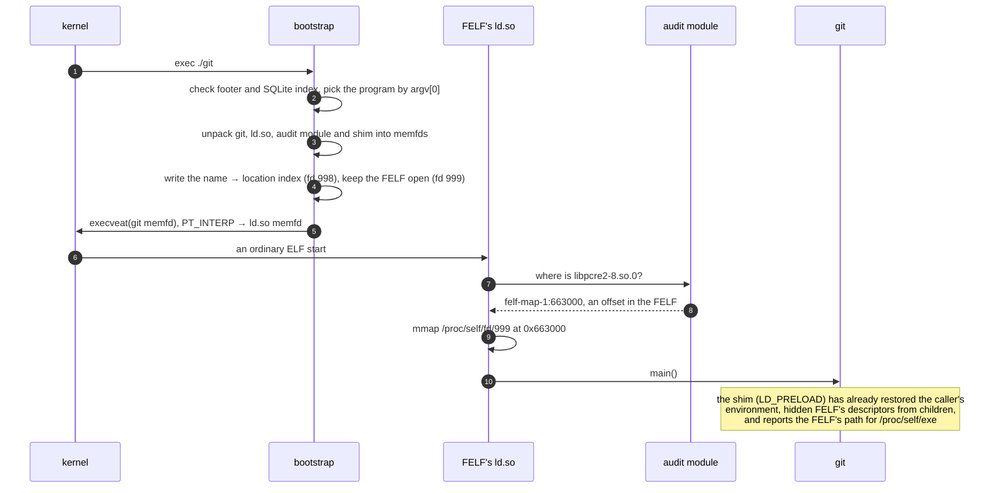
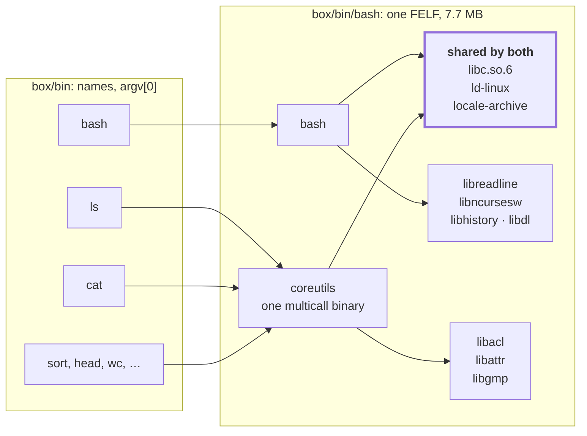

# FELF — Fat ELF

**One executable file. Its own glibc. Runs on any Linux of the same
architecture: no FUSE, no root, no runtime to install, nothing extracted to
disk.**

```console
$ felf pack $(which git) -o git
wrote git
$ ls -lh git
-rwxr-xr-x 1 you you 7.8M git
$ env -i ./git --version          # no PATH, no locale, no LD_* — still works
git version 2.56.0
```

FELF takes an ordinary dynamically linked program, as you already build it,
and packs it with every shared library it needs, a private glibc and dynamic
linker, and a read-only SQLite index into **one file that is still a valid
ELF executable**. Copy it to another distribution, an older one, or an empty
container, and the kernel runs it like any other binary.

## What's inside

```text
git
┌────────────────────────────────────────┐
│ ELF header + static bootstrap (musl)   │ ◀── the kernel executes this
├────────────────────────────────────────┤
│ git, ld-linux, audit module, shim      │ zstd ──▶ memfds at start
│ libc.so.6  libpcre2-8  libz-ng  …      │ page-aligned ──▶ mmap'ed in place
│ locale-archive                         │ unpacked only when needed
├────────────────────────────────────────┤
│ SQLite: objects, sonames, hashes, env  │ read-only index
├────────────────────────────────────────┤
│ footer (256 B)                         │ magic + offsets
└────────────────────────────────────────┘
```

## What happens when you run it



No forged auxiliary vector, no jumps into glibc internals, no temp
directory.

### Why patch the loader?

FELF didn't have to. Unpacking every library into a memfd and pointing an
unmodified `ld.so` at `/proc/self/fd/N` works, and FELF still does that for
the program itself and with `--compress LEVEL`. But a memfd belongs to one
process: every start copies every library into fresh memory, used or not,
and ten running copies hold ten private copies of libc.

So FELF ships glibc with **one small patch to `ld.so`**, which leaves
`libc.so.6` untouched: given `felf-map-1:<offset>`, the loader maps the
library straight out of the FELF file, like any `.so` on disk. The kernel's
page cache then does what it does for every other library: pages load on
first touch, unused libraries cost nothing, and every process running the
same FELF shares one copy.

| perl, packed both ways | libraries mapped (default) | libraries in memfds |
|---|---|---|
| memory, 10 processes running (PSS) | **15 MB** | 53 MB |
| start-up, `perl -e 1` | **3.4 ms** | 10.2 ms |

<sub>Measured on one x86-64 machine. The memfd build is `--compress 19`,
so its start-up also includes zstd decompression.</sub>

## One file, a whole userland

Pack several programs into one FELF and they **share the same embedded
`.so` files**. The packer resolves every program's libraries into one set,
so `libc.so.6` is stored once whether one program needs it or eleven, and
each extra program costs only its own binary.

```bash
mkdir -p box/bin
args=()
for c in ls cat sort head seq paste wc date sha256sum cut; do
    args+=(--program "$c=$(command -v "$c")")
done
felf pack bash="$(command -v bash)" "${args[@]}" -o box/bin/bash
FELF_INSTALL_LINKS=box/bin box/bin/bash      # ls -> bash, cat -> bash, …
```



| | 11 separate FELFs | 1 FELF, 11 programs |
|---|---|---|
| size on disk | 68 MB | **7.7 MB** |
| copies of libc, ld-linux, locale archive | 11 | **1** |

<sub>Here every coreutils command is the same multicall binary, so each
separate FELF carries all of it. With one binary per command the separate
FELFs are smaller, but each still carries its own libc, loader and locale
archive.</sub>

What makes it work:

- **One copy on disk.** A library several programs need is embedded once.
  Two names for the same file, like a multicall coreutils, become one
  program with aliases.
- **One copy in memory.** The page cache shares pages per file. Every
  program in the FELF maps libc from the same file at the same offset, so
  `bash`, `sort` and `tail` running side by side use one copy of it.
  Eleven separate FELFs would be eleven files, and eleven copies.
- **`argv[0]` picks the program.** The bootstrap looks up the name it was
  run as (`sort`), unpacks only that program, and runs it with that name,
  so multicall binaries like coreutils and busybox dispatch as usual. Any
  other name runs the default program, `bash`.
- **No host userland needed.** With the host's libraries hidden in a mount
  namespace and `PATH` pointing only at `box/bin`, the pipeline still runs:

```console
$ env -i PATH=$PWD/box/bin bash -c 'seq 5 | sort -r | head -2 | paste -sd,'
5,4
```

Put `box/` in a `FROM scratch` image and the whole image is one regular
file plus symlinks ([docs/nix.md](docs/nix.md#oci-image) builds one with
bash, all of coreutils and btop). It feels like a container userland, but
it's not isolation: add a namespace or a container runtime when you need
walls.

## How it compares

| | **FELF** | AppImage | Flatpak | Snap | Static linking | Docker |
|---|---|---|---|---|---|---|
| Ships as one file | ✅ | ✅ | ❌ | ❌ | ✅ | ❌ |
| Needs on the host | nothing | FUSE, or extract to `/tmp` | flatpak + runtimes | snapd | nothing | a container runtime |
| Root to install or run | no | no | no (`--user`) | yes | no | daemon, or a rootless setup |
| Brings its own libc | ✅ glibc | ❌ the host's: build on the oldest distro | ✅ runtime | ✅ base snap | ✅ | ✅ image |
| Mounts or extracts at start | nothing | squashfs over FUSE | an installed tree | squashfs loop | nothing | overlayfs |
| Takes an existing binary | ✅ as is | needs an AppDir | rebuild for the runtime | rebuild | rebuild from source | build an image |
| Host GPU drivers (GL, Vulkan) | ✅ the host's | ✅ the host's | GL extensions | interfaces | ❌ can't `dlopen` them | passthrough setup |
| Sandbox | ❌ | ❌ | ✅ | ✅ | ❌ | ✅ |

FELF is a **distribution format, not a sandbox**: it decides which libraries
a program loads, not which files it can touch. If you need isolation, run a
FELF inside one.

## Capabilities

- **Strict by default.** Only bundled libraries, files under the bundle root
  and the host graphics stack may load, and the caller's `LD_PRELOAD`,
  `LD_LIBRARY_PATH` and `LD_AUDIT` can't inject anything. `--permissive`
  lets unknown names fall back to the host.
- **Host graphics.** libGL, EGL, Vulkan, DRM, VA-API, Mesa and NVIDIA
  drivers come from the host, found the way the host's `ld.so` would.
- **Invisible to children.** A shim makes `/proc/self/exe` the FELF's path,
  and child processes get the caller's environment, without FELF's
  variables or descriptors.
- **Many programs, one file.** `--program` shares libraries between programs
  picked by `argv[0]`, and `--alias` covers multicall binaries such as
  busybox and coreutils ([see above](#one-file-a-whole-userland)).
- **Plugins and data stay files.** A *tree* bundle keeps `lib/plugins/` and
  `share/` next to the FELF (`--root`, `--plugin`) and embeds everything they
  link against, so Qt apps find their plugins, icons and `qt.conf`.
- **Lazy or eager.** `--lazy` resolves libraries on demand through the audit
  module; `--compress LEVEL` trades start-up time for size.
- **Deterministic.** Two packs of the same input are byte-for-byte identical.
- **Inspectable.** `felf inspect`, `list`, `verify` (a SHA-256 per object),
  `extract`, and read-only SQL on the index: `felf sql FILE "SELECT …"`.
- **UTF-8 everywhere.** Every FELF carries a locale archive, so programs
  start in `C.UTF-8` even in an empty container.

## Get started

**Prebuilt**: the static CLI for x86-64 or aarch64, from the
[releases](https://github.com/Rucadi/FELF/releases):

```bash
curl -Lo felf https://github.com/Rucadi/FELF/releases/download/v0.2.0/felf-0.2.0-x86_64-linux
chmod +x felf
./felf pack ./myapp -o myapp.felf && ./myapp.felf
```

**CMake**: pack as part of your build; felf is downloaded at configure time
([docs/cmake.md](docs/cmake.md)):

```cmake
include(FELF.cmake)
add_executable(app main.c)
felf_pack(app-felf TARGET app LAZY INSTALL_DESTINATION bin)   # app.felf
```

## Environment variables

| | |
|---|---|
| `FELF_DEBUG=1` | Something not loading? Logs every decision to stderr: which program, which locale archive and why, and where each library resolved (`felf[audit]: bundled libpcre2-8.so.0 -> felf-map-1:663000`). |
| `FELF_INSTALL_LINKS=DIR` | Creates `DIR/<name>` → the FELF for every program and alias, and runs nothing. |
| `FELF_ROOT` | Set for your program: the bundle root, where a tree's `share/` and `lib/` live. Children keep it. |
| `$FELF_ROOT`, `$FELF_APP`, `$VAR` | Placeholders in `--env` values, expanded at every start: `--env 'APP_DATA=$FELF_ROOT/share/app'`. |
| `FELF_BOOTSTRAP`, `FELF_AUDIT`, `FELF_SHIM` | At pack time, embed these files instead of the built-in ones, for example aarch64 builds when packing on x86-64. |

Everything else FELF sets is internal handoff, removed before `main()`: the
program sees the caller's own environment, `LD_*` included
([docs/runtime.md](docs/runtime.md#environment-variables)).


## Learn more

| | |
|---|---|
| [Architecture](docs/architecture.md) | the pieces, and how a FELF is packed and started |
| [Packing](docs/packing.md) | every `felf pack` option, dependency resolution, compression numbers |
| [Runtime](docs/runtime.md) | bootstrap, audit module, shim, direct mapping |
| [File format](docs/format.md) | layout, footer, the SQLite schema |
| [CMake](docs/cmake.md) · [Nix](docs/nix.md) | integrations |
| [Building](docs/building.md) | build from source and run the tests |
| [Security](docs/security.md) | what FELF guarantees, and what it doesn't |

## License

Apache 2.0 ([LICENSE](LICENSE)). Every FELF embeds glibc, which is LGPL:
when you redistribute FELFs, its license and source-availability terms
apply to that part, FELF's loader patch included
([src/glibc/patches](src/glibc/patches)).
