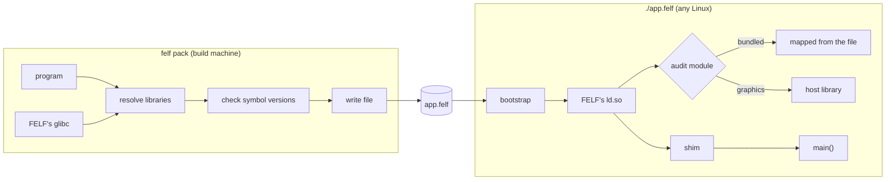

# Architecture

## The pieces

| Piece | Source | Role |
|---|---|---|
| `felf` | `src/packer/`, `src/storage/` | The CLI: packs, inspects, verifies, extracts. A static binary that embeds everything below. |
| Bootstrap | `src/bootstrap/` | Static musl program at the start of every FELF. The kernel runs it; it sets up and executes the real program. |
| FELF's glibc | `src/glibc/` | glibc with `ld.so` patched to map libraries straight from the FELF file. Every program runs on it. |
| Audit module | `src/loader/felf_audit.c` | An `LD_AUDIT` module that decides where every library comes from. |
| Shim | `src/loader/felf_runtime.c` | An `LD_PRELOAD` library that hides FELF from the program and its children. |
| Format, storage | `src/format/`, `src/storage/`, `src/include/` | Footer, SHA-256, the SQLite index, the bootstrap-to-loader protocol. |

SQLite and zstd are vendored in `third_party/`.

## Packing and running



**Packing** ([packing.md](packing.md)): the program is paired with FELF's
glibc, its `DT_NEEDED` libraries are resolved transitively, symbol versions
are checked, and everything is written into one file.

**Running** ([runtime.md](runtime.md)): the bootstrap unpacks the program,
loader, audit module and shim into memfds and `execveat`s the program. The
loader asks the audit module for each library and maps bundled ones from
the FELF file. The shim restores the caller's environment before `main()`.

## The file

```text
┌──────────────────────────┐ offset 0
│ bootstrap (static ELF)   │ what the kernel runs
├──────────────────────────┤ page-aligned
│ payload                  │ every object, each aligned for mmap
├──────────────────────────┤ page-aligned
│ SQLite index             │ objects, aliases, dependencies, env, settings
├──────────────────────────┤
│ footer (256 B)           │ locates the rest
└──────────────────────────┘
```

Details in [format.md](format.md).

## Trees

A FELF can sit inside a directory, a *tree*: the FELF in `bin/`, data and
plugins as ordinary files next to it. The packer records the *bundle root*
relative to the FELF, so plugins under it may load in strict mode and the
program finds its data through `$FELF_ROOT`. Everything the plugins link
against is embedded.
