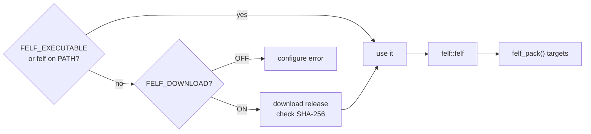

# CMake

`cmake/FELF.cmake` packs your executables into FELFs as part of the build.
It never builds FELF: it uses an installed `felf`, or downloads a released
one at configure time.



## Get the module

Each release attaches `FELF.cmake` with its binaries' SHA-256 written in.
Pin the module's hash and the binary it downloads is pinned too:

```cmake
set(felf_module "${CMAKE_BINARY_DIR}/FELF.cmake")
if(NOT EXISTS "${felf_module}")
    file(DOWNLOAD
        https://github.com/Rucadi/FELF/releases/download/v0.2.0/FELF.cmake
        "${felf_module}"
        EXPECTED_HASH SHA256=<FELF.cmake's hash from SHA256SUMS>)
endif()
include("${felf_module}")
```

Or copy `cmake/FELF.cmake` into your project. That copy has no hashes in
it, so it checks the binary against the release's `SHA256SUMS`.

## Use it

```cmake
add_library(mylib SHARED lib.c)
add_executable(myapp main.c)
target_link_libraries(myapp PRIVATE mylib)

felf_pack(myapp-felf TARGET myapp LAZY INSTALL_DESTINATION bin)
```

```bash
cmake -S . -B build
cmake --build build                    # build/myapp.felf
cmake --install build --prefix dist    # dist/bin/myapp.felf
```

With plugins, a second program and data files:

```cmake
felf_pack(myapp-felf
    TARGET myapp
    INCLUDES myplugin                  # dlopen'ed, not linked
    PROGRAMS myapp-cli=myapp_cli       # runs when invoked as myapp-cli
    ENV MYAPP_DATA=$FELF_ROOT/share/myapp
    ROOT ..                            # FELF in bin/, data in ../share
    INSTALL_DESTINATION bin)
install(DIRECTORY data/ DESTINATION share/myapp)
```

## `felf_pack(<name> …)`

Adds the custom target `<name>`, built by default, writing
`<binary dir>/<output name>.felf` (also in the target property
`FELF_OUTPUT`). It repacks when the program or any target it names
changes. Any argument naming a CMake target stands for that target's file.

| Argument | `felf pack` |
|---|---|
| `TARGET <target>` or `PROGRAM <path>` | the main program |
| `NAME <name>` | `NAME=` of the main program |
| `OUTPUT <path>` | `-o`, relative to the binary dir |
| `PROGRAMS <name>=<target\|path>…` | `--program` |
| `ALIASES <prog>=<names>…` | `--alias` |
| `INCLUDES`, `PLUGINS` `<target\|path>…` | `--include`, `--plugin` |
| `LIB_DIRS`, `HOST_LIBS` | `--lib-dir`, `--host-lib` |
| `ENV <NAME=VALUE>…` | `--env`, passed unexpanded |
| `ROOT <rel>`, `COMPRESS <level\|none>` | `--root`, `--compress` |
| `LAZY`, `PERMISSIVE`, `NO_DEFAULT_HOST_LIBS` | the same flags |
| `EXTRA_ARGS <arg>…` | passed through |
| `DEPENDS <file\|target>…` | extra dependencies |
| `EXCLUDE_FROM_ALL` | build only on request |
| `INSTALL_DESTINATION <dir>` [`INSTALL_COMPONENT <c>`] | `install(PROGRAMS)` |

Your own shared libraries are found through the build tree's `RUNPATH`.
With `CMAKE_SKIP_BUILD_RPATH`, list their directories in `LIB_DIRS`.

## Settings

| Variable | Default | Meaning |
|---|---|---|
| `FELF_EXECUTABLE` | `felf` on `PATH` | felf to use |
| `FELF_DOWNLOAD` | `ON` | download when none is found |
| `FELF_VERSION` | the module's release | release to download |
| `FELF_DOWNLOAD_DIR` | `<build>/_felf` | download cache (`<version>/felf`) |
| `FELF_RELEASE_URL` | GitHub releases | base URL, for a mirror |

After `include()`, `felf::felf` is the imported executable and
`FELF_FOUND_VERSION` its version.

## Notes

- Programs must be built for FELF's glibc (2.44) or older; any current
  distribution's toolchain qualifies.
- felf packs for its own architecture. `felf_pack` warns when
  `CMAKE_CROSSCOMPILING` is set; see [packing.md](packing.md#architectures).
- Data files go next to the FELF (`share/…`); point the program at them
  with `ENV` and `$FELF_ROOT`.
