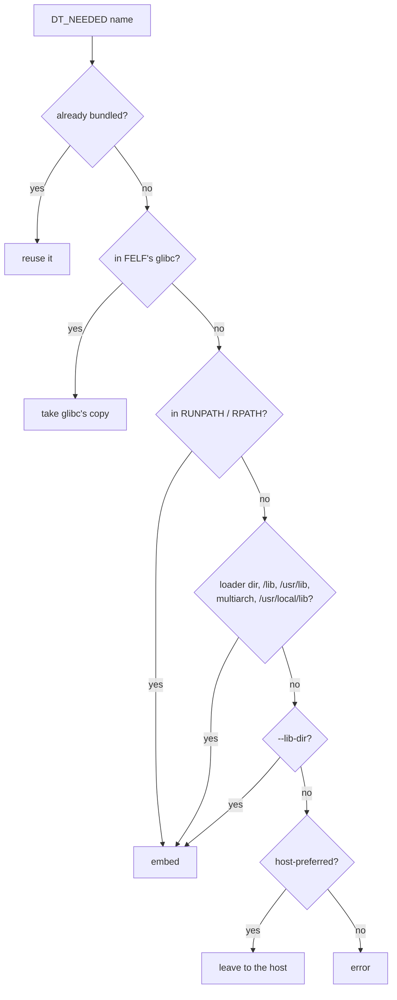

# Packing

```bash
felf pack [NAME=]PROGRAM -o OUT [options]
```

`@FILE` in the arguments is replaced by FILE's lines, one argument each
(empty lines and `#` comments skipped), for lists too long for a command
line.

## Options

| Option | Effect |
|---|---|
| `-o PATH` | Output, written to a temporary file and renamed; mode 0755 less the umask |
| `--program [NAME=]PATH` | Another program sharing the libraries, run when invoked as NAME. The same file twice becomes an alias. |
| `--alias PROG=NAME[,NAME…]` | More names for a multicall program; it runs with NAME as `argv[0]` |
| `--compress LEVEL\|none` | See [compression](#compression) |
| `--lazy` | Load libraries on demand through the audit module. Without it, memfd libraries are also put in `LD_PRELOAD`. |
| `--permissive` | Names the FELF doesn't bundle may come from the host. Default: strict. |
| `--include PATH` | Embed a library the program only `dlopen`s, and its dependencies. Already bundled names are skipped; failures are warnings. |
| `--plugin PATH` | Keep a library as a file outside the FELF, embed its dependencies |
| `--root REL` | The tree's top, relative to the FELF's directory (`..` for `tree/bin/app`). Becomes `$FELF_ROOT`; files under it may load in strict mode. |
| `--env NAME=VALUE` | Set a variable for the program; `$FELF_ROOT`, `$FELF_APP`, `$VAR`, `$$` are expanded at start |
| `--lib-dir DIR` | Extra directory to find libraries in, at pack time only |
| `--host-lib PATTERN` | Prefer the host's copy of a library (name, or prefix ending in `*`) |
| `--no-default-host-libs` | Don't prefer the host's graphics stack and NSS modules |

`FELF_BOOTSTRAP`, `FELF_AUDIT` and `FELF_SHIM` name files to embed instead
of the ones built into `felf`, for example builds for another architecture.

## What gets embedded



- `RUNPATH` (or `RPATH` when there is none) has `$ORIGIN`, `$LIB` and
  `$PLATFORM` expanded.
- Only ELF files for the target architecture match; linker scripts and
  foreign libraries are skipped. The architecture comes from the first
  program, and every object must match it.
- Every program runs on **FELF's glibc**, whatever its own `PT_INTERP`
  says: its `ld.so` becomes the interpreter and glibc's libraries come from
  it. glibc is backward compatible, so programs built for that glibc or
  older work, from any distribution.
- Every FELF embeds a locale archive (C.UTF-8, en_US.UTF-8).

## Checks

- **Symbol versions.** Every version an object needs from another embedded
  object (`DT_VERNEED`, except weak ones) must be defined there. A program
  built for a newer glibc fails: `… needs version GLIBC_x of libc.so.6,
  which the bundled libc.so.6 … does not define`.
- **Names** are unique, and program names have no `/`. Library names are
  at most 127 bytes.
- **`PT_INTERP`** is at least 18 characters, the room the bootstrap needs to
  point it at the bundled loader. Every usual glibc loader path is longer.

## Compression

| `--compress` | Libraries | Everything else | Start-up |
|---|---|---|---|
| *(not given)* | uncompressed, mapped from the file | zstd 19 | fastest, pages shared |
| `LEVEL` (1-22) | zstd LEVEL, unpacked into memfds | zstd LEVEL | smallest file, every start decompresses |
| `none` | uncompressed, mapped | uncompressed | largest file |

Compressed objects are 2 MiB zstd frames, decompressed in parallel on up to
16 threads. perl, packed both ways on one x86-64 machine:

| | default | `--compress 19` |
|---|---|---|
| file size | 10.7 MB | 5.1 MB |
| `perl -e 1` | 3.4 ms | 10.2 ms |
| memory, 10 processes running (PSS) | 15 MB | 53 MB |

**`/nix/store` scrubbing.** `/nix/store/<hash>` strings in every object
become `/nix/store/eeee…` (like nixpkgs' `nuke-refs`), so Nix sees no
dependencies in a FELF. A FELF never needs those paths: the bootstrap sets
the interpreter and the audit module resolves every library.

## Several programs

Programs in one FELF share every library ([README](../README.md#one-file-a-whole-userland)).
`argv[0]` picks the program; any other name runs the default (the
positional input).

```bash
felf pack hello=./hello --program ./tool --program cli=./cli-real -o bin/hello
felf pack ./busybox --alias "busybox=$(./busybox --list | paste -sd,)" -o bin/busybox
FELF_INSTALL_LINKS=bin bin/hello      # bin/tool, bin/cli -> hello
```

## Host libraries and plugins

The **graphics stack** always comes from the host: libglvnd (`libGL`,
`libEGL`, `libGLX`, `libOpenGL`, GLES), vendor drivers (`libGLX_*`,
`libEGL_*`, `libnvidia-*`, `libgallium-*`), Vulkan, DRM/GBM, VA-API/VDPAU
and CUDA (`src/include/felf_host_libs.h`). A copy found at pack time is
embedded and used only if the host has none.

**NSS modules** (`libnss_*`) come from the host too: `/etc/nsswitch.conf`
names the host's sources of users, groups and hosts (`systemd`, `sss`,
`ldap`, `mdns`…), and glibc loads `libnss_<source>.so.2` for each. A module
that can't load is skipped, as NSS does natively. `files` and `dns` are
built into glibc. Host libraries run against
FELF's glibc, so one built for a newer glibc won't load.

**Plugins** are never embedded. `--plugin` embeds only their dependencies.
Any plugin links against the embedded libraries; strict mode loads only
plugins under the bundle root, permissive mode any path.

## Other commands

| Command | Does |
|---|---|
| `felf inspect FILE [--json]` | modes, programs, objects, compression |
| `felf list FILE [--json]` | the objects |
| `felf verify FILE` | layout and every SHA-256 |
| `felf extract FILE --output DIR` | every object, decompressed, plus `felf.sqlite` |
| `felf sql FILE "SELECT …"` | read-only query on the index |

`extract` names files after the objects, with characters outside
`[A-Za-z0-9._+-]` replaced by `_`, and `.<id>` added when a name repeats or
would be `felf.sqlite`.

## Architectures

x86-64 and aarch64 (`src/include/felf_arch.h`); the full test suite runs on
both in CI. Packing for aarch64 on x86-64 should work with `FELF_BOOTSTRAP`,
`FELF_AUDIT` and `FELF_SHIM` pointing at aarch64 builds, but is untested.
