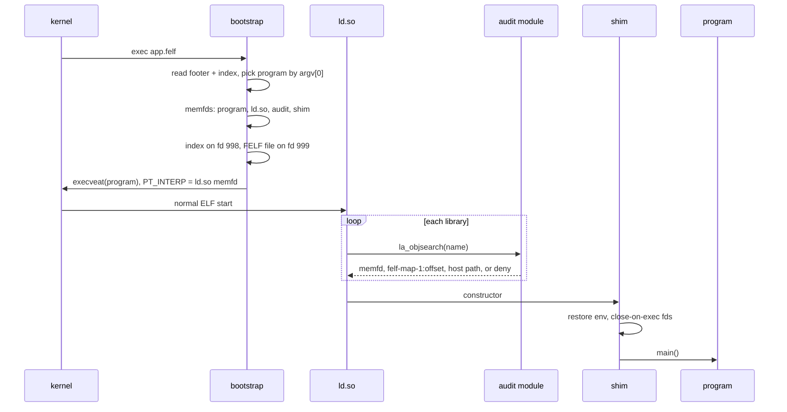
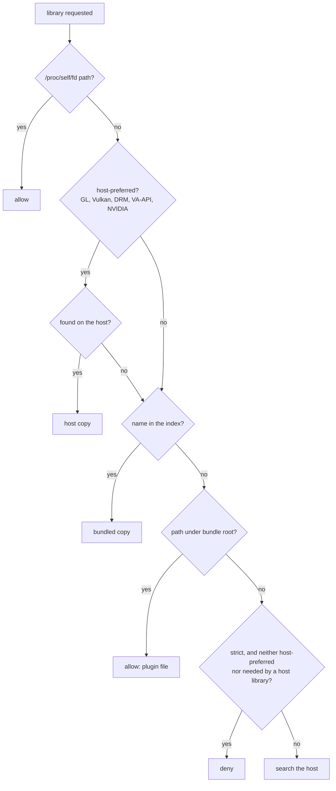

# Runtime

How a FELF starts and loads its libraries. The handoff between the pieces
is defined in `src/include/felf_loader_protocol.h`; `FELF_DEBUG=1` makes
every piece log its decisions to stderr.

## Bootstrap

`src/bootstrap/main.c`, a static musl program. In order:

1. **Find itself** via `/proc/self/exe` or `AT_EXECFN`. `/proc/self/fd` is
   required.
2. **Read the file**: check the outer ELF, footer and layout; open the
   index in memory.
3. **Pick the program** whose name or alias matches the basename of
   `argv[0]`, else the default. Only that program is unpacked.
4. **Find the bundle root**: from the program's recorded place in the tree
   if the file sits there, else from the stored relative root.
5. **Unpack objects into memfds** from fd 1000 up: the program, the loader,
   the audit module, the shim, compressed libraries, and the locale archive
   if needed. They are filled in parallel (2 MiB jobs, up to 16 threads).
   Uncompressed libraries are not copied; the FELF stays open on fd 999.
6. **Write the audit index** on fd 998: every library name, SONAME and
   alias with its location (`/proc/self/fd/N` or `felf-map-1:<offset>`),
   plus the strict flag, bundle root, host-library patterns and search
   directories.
7. **Build the environment** (see [below](#environment-variables)): the
   caller's `LD_*` are set aside as `FELF_ORIG_*`, the FELF's `--env`
   values are applied, `LD_AUDIT` and `LD_PRELOAD` point at the memfds,
   and a locale archive is chosen.
8. **Exec**: rewrite the program's `PT_INTERP` to the loader's memfd and
   `execveat(fd, "", argv, envp, AT_EMPTY_PATH)`.

The soft open-file limit is raised only if a descriptor it must use is
above it, and restored before the exec.

**Locale.** If the caller sets no `LOCALE_ARCHIVE`, the bootstrap uses the
embedded archive for a C, C.UTF-8 or unset locale, else the host's archive,
else the embedded one. With no locale at all it also sets `LANG=C.UTF-8`.

**`FELF_INSTALL_LINKS=DIR`** stops after step 2: it creates `DIR/<name>` →
the FELF for every program and alias and exits. Links are relative when
`DIR` is the FELF's own directory. Existing files are left alone; any that
isn't this FELF makes the exit status 1.

## Audit module

`src/loader/felf_audit.c` is freestanding (raw syscalls, no libc), since it
loads before libc is usable. `la_objsearch()` decides each lookup:

- Host libraries are found the way the host's loader would: caller's
  `LD_LIBRARY_PATH`, `/etc/ld.so.cache`, default and multiarch directories,
  `/run/opengl-driver/lib`. Each candidate must be an ELF for the FELF's
  architecture. The list is `src/include/felf_host_libs.h` plus
  `--host-lib`.
- A name is matched by SONAME or by the basename of a path, so a library
  is loaded once however it is requested.
- Libraries loaded from the host may pull their own dependencies from the
  host (Mesa needs libLLVM), except names the FELF bundles.
- In permissive mode, names that reach the end are searched on the host
  instead of the bundled glibc's default directories.

## Direct mapping

The patched `ld.so` accepts `felf-map-1:<hex offset>`: it opens
`/proc/self/fd/999` and maps the ELF image at that offset like any library
on disk. Each such object's identity is (device −1, offset), so two
libraries in one file never collide.

It's plain file-backed `mmap`: nothing copied at start, pages read on first
use, unused libraries free, and one copy in the page cache for every
process running the FELF. Memfds can't share like that; that's why FELF
patches the loader ([README](../README.md#why-patch-the-loader)). The patch
touches only `ld-linux`, not `libc.so.6`.

## Shim

`src/loader/felf_runtime.c`, first in `LD_PRELOAD`:

| Does | Why |
|---|---|
| Reports the FELF's path for `readlink`, `realpath` and `getauxval(AT_EXECFN)` of `/proc/self/exe` | The program runs from a memfd; toolkits look for files next to the executable |
| Removes `LD_PRELOAD`, `LD_AUDIT` and the handoff variables; turns `FELF_ORIG_<NAME>` back into `<NAME>` | Children see the caller's environment. Edits `environ` directly, since programs like bash define their own `setenv`. |
| Opens the locale archive, then removes `LOCALE_ARCHIVE` if the bootstrap set it | The path names a descriptor children don't have |
| Marks fds 998 and up close-on-exec | Children don't inherit FELF's objects |

## Environment variables

For users:

| Variable | Meaning |
|---|---|
| `FELF_DEBUG` | Any value but empty or `0`: log to stderr as `felf[bootstrap]`, `felf[audit]`, `felf[runtime]`. Inherited by children. |
| `FELF_INSTALL_LINKS=DIR` | Create the program and alias symlinks in `DIR`, run nothing |
| `FELF_ROOT` | Set for the program: the absolute bundle root. Kept for children. |
| `FELF_BOOTSTRAP`, `FELF_AUDIT`, `FELF_SHIM` | Read by `felf pack`: files to embed instead of the built-in ones |

In `--env` values, `$FELF_ROOT` is the bundle root, `$FELF_APP` the FELF
file, `$NAME` the caller's variable, and `$$` a literal `$`, expanded at
every start.

Internal, removed before `main()`:

| Variable | Meaning |
|---|---|
| `FELF_APP_PATH` | The FELF file, for the `/proc/self/exe` answer |
| `FELF_STRICT`, `FELF_HANDOFF_VERSION` | Mode and protocol version |
| `FELF_ORIG_<NAME>` | The caller's `LD_*`, set aside |
| `FELF_LOCALE_ARCHIVE_SET` | The bootstrap chose `LOCALE_ARCHIVE` |

Build-time `FELF_*` names are in [building.md](building.md).
