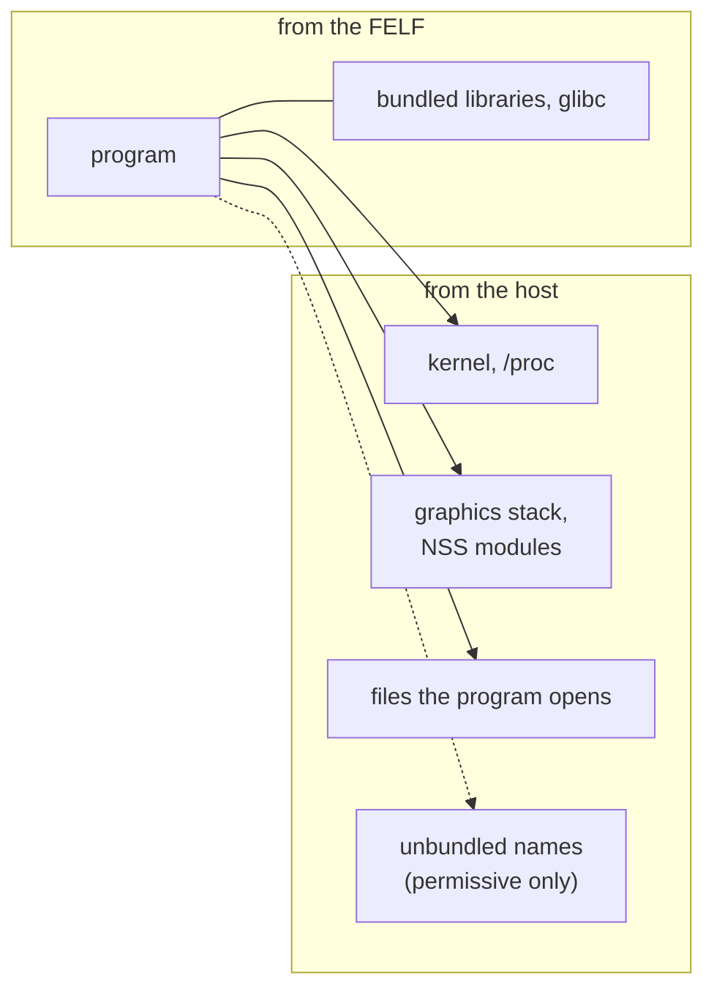

# Security

FELF controls **which libraries a program loads**. It is not a sandbox: the
program runs with the caller's privileges and can read and run anything
they can.

## Guarantees

- **Bundled libraries win.** The caller's `LD_PRELOAD`, `LD_LIBRARY_PATH`,
  `LD_AUDIT` and other `LD_*` are removed before the bundled loader starts;
  the shim gives them back to child processes. A bundled name always
  resolves to the bundled copy.
- **Strict mode** (default): only bundled objects, files under the bundle
  root, the host graphics stack and the host's NSS modules may load.
- **Nothing on disk.** Objects become memfds or are mapped read-only from
  the FELF itself.
- **Nothing leaks to children.** FELF's descriptors (998 and up) are
  close-on-exec once the program runs.
- **No store paths.** `/nix/store` paths in embedded objects are scrubbed,
  so they can't resolve to a host's store.

## Limits

- **Integrity, not authenticity.** Every object has a SHA-256 that
  `felf verify` checks, but the file isn't signed: whoever can modify it
  can update the hashes. The bootstrap checks the layout at every start,
  not the hashes.
- **Host code runs inside the program**: the graphics stack, NSS modules
  and whatever they load (`--no-default-host-libs` turns this off), and in
  permissive mode any name the FELF doesn't bundle.
- **`/proc/self/fd` is required.**
- **Programs run from memory** (memfds). A host that forbids executable
  memfds (`sysctl vm.memfd_noexec=2`, some SELinux policies) can't run a
  FELF; the bootstrap says so.
- **No set-user-ID or set-group-ID.** The bootstrap refuses to start that
  way: glibc ignores `LD_AUDIT` and `LD_PRELOAD` paths in such a process.
- **Descriptors 998 and up belong to FELF** while the program runs. A
  program that closes every descriptor it didn't open (`closefrom`,
  `close_range`) can no longer load libraries afterwards.
